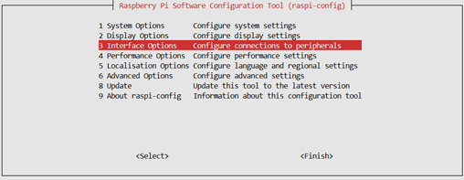
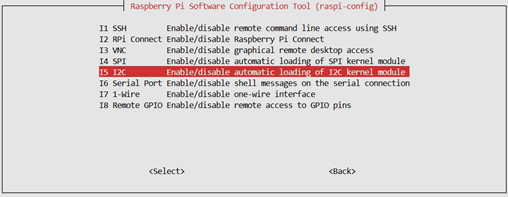
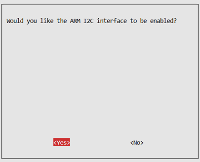
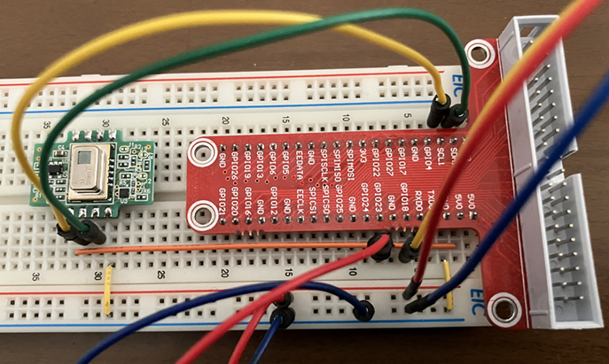
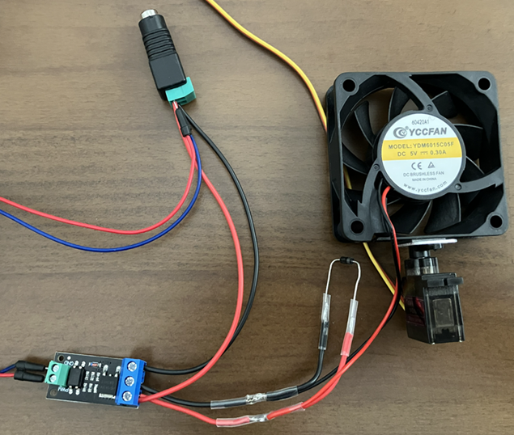

# AI扇風機

## 概要

本システムは電子工作・AI開発の学習を目的として、AIカメラ、赤外線アレイセンサー、サーボモーター、DCファンを組み合わせた試作システムです。

カメラで人の位置を検知し、AMG8833で周囲の温度分布を取得し、人がいる方向を避けつつ送風方向を判断し、サーボモーターとファンを制御します。

## 主な機能

- カメラおよびセンサーによる実世界の情報取得
- AIによる人物認識
- GPIOによる電子部品制御
- アクチュエータによる物理動作

---

## システム構成

```text
                    Raspberry Pi 4
                          │
         ┌────────────────┴────────────────┐
         │                                 │
         ▼                                 ▼
     AIカメラ                           AMG8833
         │                                 │
         ▼                                 ▼
      人検知                            温度取得
         │                                 │
         ▼                                 ▼
   左・中央・右に分類                 左・中央・右に分類
         │                                 │
         └──────────────┬──────────────────┘
                        ▼
                   判断ロジック
                        │
             ┌──────────┴──────────┐
             ▼                     ▼
           MG90S                  D4184
             │                     │
             ▼                     ▼
          方向制御              ファン制御
             │                     │
             └──────────┬──────────┘
                        ▼
                     送風動作
```

処理は基本的に以下の流れで繰り返します。

1. AMG8833から温度情報を取得する
2. AIカメラから人物検知結果を取得する
3. 温度と人物位置を左・中央・右に分類する
4. 送風方向を判断する
5. MG90Sでファンの向きを変更する
6. D4184を介してファンを制御する
7. 一定時間後に再度判断する

現在は3秒周期で処理を繰り返します。

---

## 送風方向の判断

送風方向は `LEFT`、`CENTER`、`RIGHT`、`NONE` の4状態で扱います。

主な判断方針は以下です。

- 人が存在する方向には送風しない
- 送風可能な候補のうち、人から遠い方向を優先する
- 人の位置だけで方向を決められない場合は、温度情報を使用する
- 方向ごとの代表温度には、各領域の単純平均を使用する
- 現在方向と次候補の温度差が小さい場合は、現在方向を維持する
- 現在方向に人を検知した場合は、温度差が小さくても別方向へ変更する
- 全方向に人が存在する場合は `NONE` として送風を停止する

温度差による方向変更のしきい値は設定値（`config.json` の `temperature.direction_change_threshold`）として扱います。

---

## 人物検知

AIカメラで取得した画像に対してMobileNet-SSDを使用して人物を検知します。

検知した人物のBounding Boxの中心X座標を使用し、画像上の位置を以下の3方向へ分類します。

```text
LEFT   : 0 ～ 239 px
CENTER : 240 ～ 399 px
RIGHT  : 400 ～ 639 px
```

複数人を検知した場合は、複数方向が同時に「人あり」となることを想定しています。

---

## 温度取得・分類

AMG8833から8×8の温度データを取得します。

8列を以下のように3方向へ分類します。

```text
LEFT   : 1 ～ 3列
CENTER : 4 ～ 5列
RIGHT  : 6 ～ 8列
```

各領域の単純平均を代表温度として使用し、方向判断へ渡します。

---

## 主なハードウェア

| 部品 | 用途 |
|---|---|
| Raspberry Pi 4 Model B 4GB | システム全体の制御 |
| Raspberry Pi Camera | 人物検知用画像の取得 |
| AMG8833 | 8×8温度分布の取得 |
| MG90S | ファンの方向制御 |
| D4184 MOSFETモジュール | DCファンのON/OFF制御 |
| 5V DCファン | 送風 |
| 1N5819 | ファン側の保護用ダイオード |
| 外部5V電源 | ファン、サーボ等への電源供給 |

主なGPIOは以下を使用しています。

| 用途 | GPIO |
|---|---:|
| MG90S制御 | BCM 18 |
| D4184 / ファン制御 | BCM 23 |

Raspberry Piと外部電源を使用する回路ではGNDを共通化しています。

---

## 技術スタック

- OS: Raspberry Pi OS Bookworm 64bit
- 言語: Python 3.11.2
- 画像処理: OpenCV
- カメラ: Picamera2
- AIモデル: MobileNet-SSD
- 入出力: GPIO Zero, Adafruit AMG88xx Library

## 依存パッケージ

### Pythonパッケージ（requirements.txt）

|パッケージ|用途|
|--|--|
|adafruit-circuitpython-amg88xx|AMG8833から温度情報を取得|

### システムパッケージ

|パッケージ|用途|
|--|--|
|python3-picamera2|カメラ制御|
|python3-gpiozero|GPIO制御|
|python3-opencv|画像処理|
|python3-numpy|画像データ処理|

## ディレクトリ構成

```text
ai-fan/
├── camera.py
├── config.py
├── config_example.json
├── coordinate.py
├── detector.py
├── detect_info.py
├── detect_result.py
├── direction.py
├── direction_judgment.py
├── fake_person_detector.py
├── fake_servo_moter.py
├── fake_thermometer.py
├── fan.py
├── main.py
├── person_detector.py
├── requirements.txt
├── servo_motor.py
├── size.py
├── temperature_result.py
└── thermometer.py
```
## セットアップ

```bash
sudo apt install python3-opencv -y
cd ai-fan
python3 -m venv --system-site-packages venv
source venv/bin/activate
pip install -r requirements.txt
cp config_example.json config.json
```

I<sup>2</sup>Cが有効か確認するために以下のコマンドを実行してください。

```bash
ls /dev/i2c-*
```

`/dev/i2c-1` が存在しない場合は以下の手順で有効化してください。

```bash
sudo raspi-config
```







再度、 `ls /dev/i2c-*` を実行し、 `/dev/i2c-1` が存在することを確認してください。

有効化後、I<sup>2</sup>Cバス1上の機器を確認するために以下を実行してください。

```bash
i2cdetect -y 1
```

以下のように表示されれば認識されています。（以下はAMG8833のアドレス）

```text
     0  1  2  3  4  5  6  7  8  9  a  b  c  d  e  f
00:                         -- -- -- -- -- -- -- -- 
10: -- -- -- -- -- -- -- -- -- -- -- -- -- -- -- -- 
20: -- -- -- -- -- -- -- -- -- -- -- -- -- -- -- -- 
30: -- -- -- -- -- -- -- -- -- -- -- -- -- -- -- -- 
40: -- -- -- -- -- -- -- -- -- -- -- -- -- -- -- -- 
50: -- -- -- -- -- -- -- -- -- -- -- -- -- -- -- -- 
60: -- -- -- -- -- -- -- -- -- 69 -- -- -- -- -- -- 
70: -- -- -- -- -- -- -- --
```

## モデル

モデルを配置するディレクトリへ移動し、以下のコマンドを実行してください。

```bash
wget https://raw.githubusercontent.com/chuanqi305/MobileNet-SSD/master/deploy.prototxt
wget https://raw.githubusercontent.com/chuanqi305/MobileNet-SSD/master/mobilenet_iter_73000.caffemodel
```

ダウンロードが終了したら、`config.json` の `detector.model_path` と `detector.prototxt_path` を変更してください。

## 設定ファイル（config.json）

```json
{
    "general": {
        "interval": 3.0
    },
    "temperature": {
        "direction_change_threshold": 1.0
    },
    "detector": {
        "model_path": "path/to/model.caffemodel",
        "prototxt_path": "path/to/label.prototxt",
        "threshold": {
            "person": 0.5 
        },
        "width": 300,
        "height": 300,
        "write_image": false,
        "image_file_path": "path/to/image.jpg",
        "fake": {
            "enabled": false,
            "confidences": [
                [0.1, 0.1, 0.1],
                [0.9, 0.8, 0.7]
            ],
            "raise_error_at": -1
        }
    },
    "servo": {
        "pin": 18,
        "left": 0.6,
        "center": 0.0,
        "right": -0.7,
        "fake": {
            "enabled": false,
            "raise_error_at": 1
        }
    },
    "fan": {
        "pin": 23
    },
    "camera": {
        "wait_sec": 2.0,
        "format": "RGB888",
        "frame": {
            "width": 640,
            "height": 480,
            "region": {
                "1": 240,
                "2": 400,
                "3": 640
            }
        }
    },
    "thermometer": {
        "address": 105,
        "initial_wait": 2.0,
        "interval": 0.1,
        "region_ratio": [3, 2, 3],
        "fake": {
            "enabled": false,
            "temperatures": [
                [1, 2, 3],
                [1, 3.5, 3],
                [1, 4, 3]
            ],
            "raise_error_at": -1
        }
    }
}
```

|キー|設定値|
|--|--|
|general.interval|メインループの実行間隔（秒）|
|temperature.direction_change_threshold|風向き変更判断に使用する温度差（℃）|
|detector.model_path|推論に使用するモデルのパス|
|detector.prototxt_path|モデルの構造定義ファイルのパス|
|detector.threshold.person|`人`と判断するためのしきい値|
|detector.width|推論の画像サイズ（幅）|
|detector.height|推論の画像サイズ（高さ）|
|detector.write_image|推論に使用した画像（バウンディングボックスあり）を出力する場合はTrue|
|detector.fake.enabled|Fakeを使用する場合はTrue|
|detector.fake.confidences|推論結果の確信度<br>登録したデータをローテーションで使用する|
|detector.fake.raise_error_at|エラーを発生させるためのdetector.fake.confidencesのインデックス<br>例外が不要であれば`-1`を設定|
|servo.pin|GPIOのBCM番号|
|servo.left|サーボモーターを左に回転させるときの設定値|
|servo.center|サーボモーターの中央位置の設定値|
|servo.right|サーボモーターを右に回転させるときの設定値|
|servo.fake.enabled|Fakeを使用する場合はTrue|
|servo.fake.raise_error_at|エラーを発生させるまでの動作回数（`1`の場合は2回目の方向変更でエラーが発生する）<br>例外が不要であれば`-1`を設定|
|fan.pin|GPIOのBCM番号|
|camera.wait_sec|カメラの起動待ち時間|
|camera.format|色情報|
|camera.frame.width|カメラの画像サイズ（幅）|
|camera.frame.height|カメラの画像サイズ（高さ）|
|camera.frame.region.1|人の位置を分類する画像領域（左）<br>`0`～`指定した値-1`が左の領域となる|
|camera.frame.region.2|人の位置を分類する画像領域（中央）<br>`camera.frame.region.1の値`～`指定した値-1`が中央の領域となる|
|camera.frame.region.3|人の位置を分類する画像領域（右）<br>`camera.frame.region.2の値`～`指定した値-1`が右の領域となる|
|thermometer.address|AMG8833のアドレス（10進数）|
|thermometer.initial_wait|センサーの起動待ち時間|
|thermometer.interval|データ取得待ち時間|
|thermometer.region_ratio|8列のデータを`左・中央・右`に分割する割合|
|thermometer.fake.enabled|Fakeを使用する場合はTrue|
|thermometer.fake.temperatures|温度データ<br>登録したデータをローテーションで使用する|
|thermometer.fake.raise_error_at|エラーを発生させるためのthermometer.fake.temperaturesのインデックス<br>例外が不要であれば`-1`を設定|


## 実行方法

`ai-fan` ディレクトリへ移動し、以下を実行してください。

```bash
python main.py
```

`Ctrl + C` で停止します。

---

## 配線





```text
Raspberry Pi
 SDA1   / 物理 3番 ─────── AMG8833 SDA
 5V0    / 物理 4番 ─────── AMG8833 VIN
 SCL1   / 物理 5番 ─────── AMG8833 SCL
 GND    / 物理 6番 ─────── ブレッドボード －レール
 GPIO18 / 物理12番 ─────── MG90S 橙線
 GPIO23 / 物理16番 ─────── D4184 PWM

5V電源
 ＋ ───────────────────── ブレッドボード ＋レール
 － ───────────────────── ブレッドボード －レール

D4184
 ＋   ──┬──────────────── 5V電源 ＋
        ├──────────────── ファン赤
        └──────────────── 1N5819 銀帯側（カソード）
 LOAD ──┬──────────────── ファン黒
        └──────────────── 1N5819 帯なし側（アノード）
 ー   ─────────────────── 5V電源 －
 PWM  ─────────────────── Raspberry Pi GPIO23
 GND  ─────────────────── ブレッドボード －レール

MG90S（線の色の表記は製品付属の説明書の通り）
 茶線 ─────────────────── ブレッドボード －レール
 赤線 ─────────────────── ブレッドボード ＋レール
 橙線 ─────────────────── Raspberry Pi GPIO18

AMG8833
 VIN ──────────────────── Raspberry Pi 5V0
 SDA ──────────────────── Raspberry Pi SDA1
 SCL ──────────────────── Raspberry Pi SCL1
 GND ──────────────────── ブレッドボード －レール
```

---

## 検証

単体機能から段階的に統合し、最終的に以下のようなシナリオを確認しています。

- 人がいない場合の温度による方向選択
- 左・中央・右それぞれに人がいる場合の回避
- 複数方向に人がいる場合
- 全方向に人がいる場合のファン停止
- 温度差が小さい場合の方向維持
- AMG8833取得異常時
- 人物検知処理の異常時
- サーボ制御処理の例外発生時
- ファンが回転しない場合の原因切り分け
- 実センサー → AI処理 → 判断 → サーボ → ファンまでの一連動作

---

## 異常時の扱いと制約

ソフトウェア処理中に例外が発生した場合は、通常制御を継続せず、終了処理によってファン等を停止する構成としています。

一方で、現在の構成には以下の制約があります。

- MG90Sの実際の位置を取得するフィードバック機能はない
- ファンが実際に回転しているかをソフトウェアから確認する機能はない
- Fakeによる異常試験は、実ハードウェアのすべての故障状態を再現するものではない

そのため、物理的な故障についてはソフトウェアだけでは検出できない場合があります。

主なFakeは以下の通りです。

- `FakePersonDetector`
  - 人が存在する方向を任意に設定
  - 複数方向・全方向人あり等を再現
- `FakeThermometer`
  - 左・中央・右の温度条件を任意に設定
  - 高温方向、同温度、微小温度差等を再現
- `FakeServoMoter`
  - 方向変更時の例外を意図的に発生させ、異常終了処理を確認
